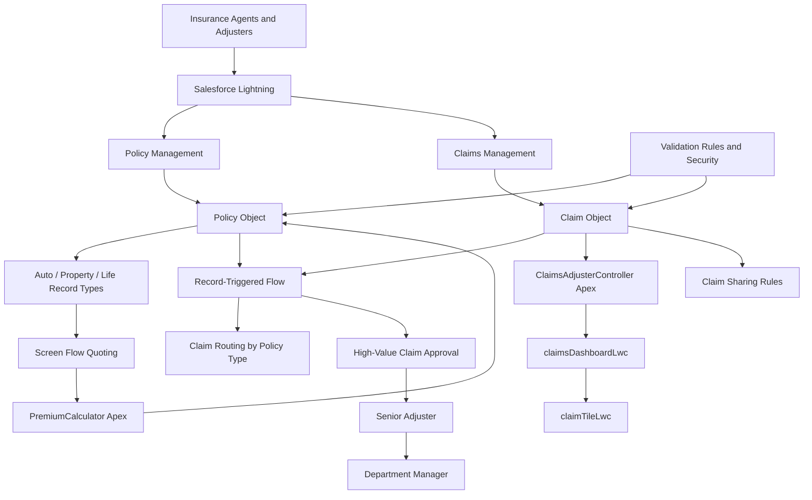
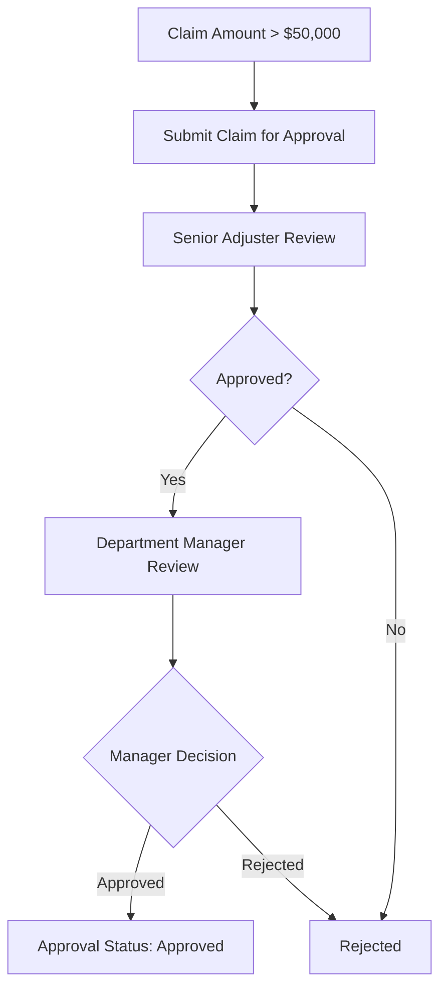

# 🛡️ Multi-Line Insurance Policy and Claims Management System — Salesforce Implementation

<p align="center">

**A Salesforce-Based Insurance Policy, Quoting, and Claims Management Solution**

Streamlining insurance quoting, policy issuance, premium calculation, claim routing, approval workflows, and claims handling through Salesforce automation and customization.

</p>

---

## 📌 Table of Contents

- [Overview](#-overview)
- [Problem Statement](#-problem-statement)
- [Project Objectives](#-project-objectives)
- [Key Features](#-key-features)
- [Insurance Lines Supported](#-insurance-lines-supported)
- [Salesforce Data Model](#-salesforce-data-model)
- [Technology Stack](#️-technology-stack)
- [System Architecture](#-system-architecture)
- [Policy Quoting and Premium Calculation](#-policy-quoting-and-premium-calculation)
- [Claims Management and Automation](#-claims-management-and-automation)
- [Approval Workflow](#-approval-workflow)
- [Lightning Web Components](#-lightning-web-components)
- [Security and Access Control](#-security-and-access-control)
- [Testing and Validation](#-testing-and-validation)
- [Project Documentation](#-project-documentation)
- [Project Demo](#-project-demo)
- [Implementation Phases](#-implementation-phases)
- [Business Benefits](#-business-benefits)
- [Challenges and Learning Outcomes](#-challenges-and-learning-outcomes)
- [Deployment](#-deployment)
- [Future Enhancements](#-future-enhancements)
- [Conclusion](#-conclusion)
- [Author](#-author)

---

## 🚀 Overview

The **Multi-Line Insurance Policy and Claims Management System** is a Salesforce-based solution designed to manage insurance policies and claims for vehicle, property, and life insurance.

Traditional insurance operations can involve manual policy quoting, inconsistent data entry, time-consuming claim reviews, and disconnected customer and policy records. These challenges can increase operational effort and make it difficult for insurance agents and claims adjusters to manage their work efficiently.

This project uses Salesforce to bring policy configuration, guided quoting, premium calculation, claim routing, approval workflows, and claims monitoring into a centralized platform.

The solution combines Salesforce custom objects, record types, field sets, Screen Flows, Record-Triggered Flows, Apex classes, Lightning Web Components (LWC), approval processes, validation rules, and permission sets.

The project demonstrates how Salesforce CRM customization and automation can support insurance business processes while maintaining structured data and role-based access.

### 🎯 Project at a Glance

| Attribute | Details |
|---|---|
| Project Name | Multi-Line Insurance Policy and Claims Management System |
| Project Type | Salesforce CRM Implementation |
| Domain | Insurance and Claims Management |
| Platform | Salesforce Lightning |
| Insurance Lines | Vehicle, Property, and Life |
| Backend Logic | Apex |
| Frontend | Lightning Web Components (LWC) |
| Automation | Screen Flows and Record-Triggered Flows |
| Approval Management | Salesforce Approval Processes |
| Data Management | Custom Objects, Record Types, Field Sets |
| Security | Permission Sets and Sharing Rules |
| Documentation | Implementation PDF and project demonstration video |

---

## ❗ Problem Statement

An insurance carrier managing vehicle, property, and life insurance uses a legacy system that relies on manual processes for policy quoting, policy issuance, and claims handling.

The absence of a unified platform creates several challenges:

- Slow and inconsistent policy quoting and issuance.
- Difficulty managing different data requirements for multiple insurance products.
- Manual claim review and routing.
- Long claim resolution times and increased operational effort.
- Limited visibility across customer, policy, and claim information.
- Complex approval handling for high-value claims.
- Data accuracy and compliance concerns.
- Difficulty monitoring claims assigned to individual adjusters.

**Proposed solution:** Build a centralized Salesforce application that standardizes insurance policy data, guides agents through quoting processes, calculates premiums using Apex, routes claims automatically, and provides claims adjusters with a dedicated dashboard.

---

## 🎯 Project Objectives

The primary objectives of this project are to:

1. Create a flexible data model for Vehicle, Property, and Life insurance policies.
2. Standardize policy quoting using guided Salesforce Screen Flows.
3. Capture insurance-specific information using record types and field sets.
4. Calculate policy premiums using a custom Apex class.
5. Automate claim routing based on the associated policy type.
6. Develop a claims dashboard using Lightning Web Components and Apex.
7. Automate high-value claim approval and escalation.
8. Provide an approval interface for claim reviewers.
9. Enforce data validation and maintain consistent policy information.
10. Configure security permissions for insurance agents, adjusters, and managers.
11. Support claim visibility according to configured policy-state sharing rules.
12. Improve operational visibility through structured claim information and dashboard filtering.

---

## ✨ Key Features

### 1. Multi-Line Insurance Policy Management

Create and manage insurance policies for different insurance products in a single Salesforce object.

The Policy object uses record types to distinguish Vehicle, Property, and Life insurance while maintaining a common structure for shared policy information.

Common policy fields include:

- Policy Number
- Customer
- Policy Start Date
- Policy State
- Premium
- Policy-specific information

This design supports a unified policy management process without requiring a separate primary policy object for every insurance line.

### 2. Policy Record Types and Field Sets

The Policy object is configured with separate record types for:

- Auto
- Property
- Life

Field sets organize the information needed for each insurance product.

| Insurance Type | Product-Specific Fields |
|---|---|
| Vehicle / Auto | VIN and Model Year |
| Property | Square Footage and Year Built |
| Life | Beneficiary Name and Policy Term Months |

This configuration supports product-specific data collection while retaining a shared policy data model.

### 3. Guided Policy Quoting

The `AutoQuotingFlow` Screen Flow guides agents through vehicle insurance quote creation.

The flow is designed to:

1. Retrieve the Auto policy record type.
2. Capture basic policy information.
3. Collect the customer and policy start date.
4. Capture vehicle details such as VIN and model year.
5. Create a draft policy record.
6. Invoke the premium calculation Apex action.
7. Update the policy with the calculated premium.

This guided process helps standardize vehicle policy data entry.

### 4. VIN Validation

A validation rule named `VIN_Must_Be_17_Characters` checks that the VIN for Auto policies contains exactly 17 characters.

If the VIN does not meet the configured requirement, Salesforce displays an error and prevents the invalid record from being saved.

This helps improve the accuracy of vehicle policy information.

### 5. Automated Premium Calculation

The `PremiumCalculator` Apex class calculates a policy premium using the policy's state and model year.

The documented sample calculation uses a base premium of $1,000, applies state-specific adjustments, and adds an additional amount for older vehicle models.

The result is returned to the quoting flow and stored in the policy's Premium field.

### 6. Automated Claim Routing

A Record-Triggered Flow retrieves the policy associated with a newly created claim and routes the claim according to its policy record type.

The documented routing paths are:

- Auto Claim Route
- Property Claim Route
- Life Claim Route

Each path assigns the claim to its configured queue using the claim's Owner ID.

This workflow provides a foundation for organizing claims by insurance product.

### 7. Claims Adjuster Dashboard

The custom Lightning Web Component `claimsDashboardLwc` displays claims assigned to the logged-in user.

The dashboard retrieves data through `ClaimsAdjusterController` and supports client-side filtering by policy type.

Claim information includes:

- Claim Number
- Claim Amount
- Approval Status
- Policy Type
- Policyholder Name
- Days Open

This helps adjusters focus on their assigned claims and review essential claim information from one interface.

### 8. Reusable Claim Cards

The `claimTileLwc` component presents each claim in a reusable card layout.

The component displays key claim details and selects an icon according to the policy type:

- Auto
- Property
- Life

Using a reusable component helps keep the claims dashboard organized and consistent.

### 9. High-Value Claim Approval

The `High Value Claim Approval` approval process is configured for claims with a claim amount greater than $50,000.

The approval process contains two sequential approval steps:

1. Senior Adjuster review.
2. Department Manager review.

The workflow includes approval-status field updates for submission, approval, and rejection.

### 10. Automated Approval Submission

The `Submission Automation Flow` is designed to submit qualifying claims to the approval process when the claim amount is greater than $50,000 and the Approval Status is New.

This reduces the need for manual submission of eligible high-value claims.

### 11. Claim Review Screen Flow

The `Claim Approver Screen Flow` provides a screen-based interface for reviewing claim information.

The flow is designed to:

- Retrieve the selected claim.
- Display claim details and policy type.
- Collect an approval decision.
- Capture approver comments.
- Provide approval-related actions.

A corresponding `Approve/Reject Claim` quick action makes the flow accessible from the Claim record page.

### 12. Role-Based Permissions

Permission sets separate access according to user responsibilities.

The documented permission sets are:

- `Insurance Agent Access`
- `Claims Manager Access`
- `Claims Adjuster Access`

These configurations help distinguish quoting activities, claim handling, reporting, and approval responsibilities.

### 13. Policy-State-Based Claim Sharing

The implementation includes a configuration workflow intended to capture the policyholder's state on the claim record and use that value in claim-sharing rules.

The documented sharing rules cover California (`CA`) and Texas (`TX`) criteria, with Read/Write access configured for the corresponding rules.

This demonstrates the use of Salesforce sharing configuration to support state-based claim visibility.

---

## 🧾 Insurance Lines Supported

The system is designed around three insurance product categories.

### 🚗 Vehicle Insurance

Vehicle policies can store:

- Vehicle Identification Number (VIN)
- Model Year
- Policy State
- Customer
- Policy Start Date
- Premium

The Auto quoting flow and VIN validation rule support the vehicle policy workflow.

### 🏠 Property Insurance

Property policies support property-specific information, including:

- Square Footage
- Year Built
- Customer
- Policy Start Date
- Premium

The Property record type and field set organize the fields relevant to property insurance.

### ❤️ Life Insurance

Life policies support fields such as:

- Beneficiary Name
- Policy Term Months
- Customer
- Policy Start Date
- Premium

The Life record type and corresponding field set help distinguish life insurance data from other insurance products.

---

## 🗂️ Salesforce Data Model

The core data model uses two primary custom objects and Salesforce Contact and User records.

| Object | API Name | Purpose |
|---|---|---|
| Policy | `Policy__c` | Stores policy details and product-specific insurance information |
| Claim | `Claim__c` | Stores claim information, claim amounts, dates, and approval status |
| Contact | Standard Salesforce object | Represents the customer associated with a policy |
| User | Standard Salesforce object | Represents adjusters and other Salesforce users |

### Policy Object

The Policy object uses an auto-number policy identifier with the documented format `P-{0000}`.

Important fields include:

| Field | Data Type |
|---|---|
| Customer | Lookup to Contact |
| Policy Start Date | Date |
| Premium | Currency |
| Model Year | Text |
| VIN | Text |
| Square Footage | Number |
| Year Built | Text |
| Beneficiary Name | Text |
| Policy Term Months | Number |

Record types distinguish Auto, Property, and Life policies.

### Claim Object

The Claim object uses an auto-number claim identifier with the documented format `C-{0000}`.

Important fields include:

| Field | Data Type |
|---|---|
| Adjuster | Lookup to User |
| Approval Status | Picklist |
| Claim Amount | Currency |
| Date of Loss | Date/Time |
| Description | Long Text Area |
| Policy | Lookup to Policy |

The Approval Status picklist includes:

- New
- Submitted for Approval
- Approved
- Rejected

The Claim object also uses record types for different claim categories.

### Object Relationships

| Relationship | Type |
|---|---|
| Policy → Contact | Lookup |
| Claim → Policy | Lookup |
| Claim → User / Adjuster | Lookup |

These relationships allow claim records to be associated with their policy information and customer details.

---

## 🛠️ Technology Stack

| Technology | Purpose |
|---|---|
| Salesforce CRM | Core insurance management platform |
| Salesforce Lightning | Application interface |
| Custom Objects and Fields | Policy and claim data storage |
| Record Types | Differentiating insurance products and claim categories |
| Field Sets | Organizing product-specific policy fields |
| Salesforce Screen Flow | Guided policy quoting and claim review |
| Record-Triggered Flow | Claim routing and approval submission automation |
| Apex | Premium calculation and claims data retrieval |
| Lightning Web Components (LWC) | Interactive claims dashboard and claim cards |
| SOQL | Retrieving claims and related policy/customer data |
| Approval Processes | Sequential review of high-value claims |
| Validation Rules | Enforcing VIN requirements |
| Quick Actions | Launching claim review workflows |
| Permission Sets | Managing user permissions |
| Sharing Rules | Configuring claim record visibility |
| Apex Test Classes | Validating controller behavior |

---

## 🏗️ System Architecture

The following diagram represents the logical architecture of the Salesforce implementation.



### Architecture Explanation

1. **User interface:** Salesforce Lightning provides the workspace for insurance agents, adjusters, and managers.
2. **Data layer:** Policy and Claim custom objects store the primary insurance records.
3. **Quoting layer:** Screen Flow guides policy data entry and invokes Apex for premium calculation.
4. **Automation layer:** Record-Triggered Flow routes claims and submits eligible high-value claims for approval.
5. **Presentation layer:** LWC components display assigned claims and provide policy-type filtering.
6. **Security layer:** Permission sets and sharing rules control access to records and functionality.

---

## ⚙️ Policy Quoting and Premium Calculation

### A. AutoQuotingFlow

**Flow Name:** `AutoQuotingFlow`

The quoting workflow is designed to create a draft Auto policy and calculate its premium.

The flow includes:

1. **Get Vehicle RT ID:** Retrieves the Auto record type for the Policy object.
2. **Basic Information Screen:** Captures the customer, policy start date, and policy state.
3. **Vehicle-Specific Details:** Collects VIN and model year.
4. **Create Draft Policy:** Creates the Policy record and stores its ID in `varPolicyId`.
5. **Calculate Premium Action:** Invokes the `PremiumCalculator` Apex method.
6. **Update Policy With Premium:** Saves the calculated premium to the created policy.

### B. PremiumCalculator Apex Class

The `PremiumCalculator` class exposes an invocable method named `calculatePremium`, allowing the calculation to be called from Salesforce Flow.

The documented calculation logic uses:

- Base premium: $1,000.
- California (`CA`): 15% increase.
- Texas (`TX`): 5% increase.
- Vehicle model year earlier than 2018: Additional $100.

The calculation can be summarized as:

| Condition | Calculation |
|---|---|
| Base premium | $1,000 |
| State is CA | Base premium × 1.15 |
| State is TX | Base premium × 1.05 |
| Model year is before 2018 | Add $100 |

These values describe the project's example rating logic; they are not real-world insurance pricing recommendations.

### C. VIN Validation Rule

**Validation Rule:** `VIN_Must_Be_17_Characters`

The documented validation formula is:

```text
AND(
    RecordType.DeveloperName = "Auto",
    LEN(VIN__c) <> 17
)
```

The rule applies to Auto policies and requires a VIN length of exactly 17 characters.

---

## 📊 Claims Management and Automation

### A. Claim Routing Flow

The Record-Triggered Flow is configured to run after a Claim record is created.

It retrieves the associated Policy record, evaluates the policy record type, and routes the claim through the corresponding decision path.

| Policy Type | Routing Path |
|---|---|
| Auto | Assign to Auto Queue |
| Property | Assign to Property Queue |
| Life | Assign to Life Queue |

The implementation documentation describes queue assignment through Owner ID. Queue identifiers must be configured for the target Salesforce organization.

### B. ClaimsAdjusterController

**Apex Class:** `ClaimsAdjusterController`

The controller retrieves claims owned by the currently logged-in Salesforce user.

The method `getAssignedClaims()` uses SOQL to retrieve claim details and related policy/customer information. It returns data through a wrapper class named `ClaimWrapper`.

The wrapper exposes:

- Claim ID
- Claim Number
- Claim Amount
- Approval Status
- Policy Type
- Policyholder Name
- Days Open

The method is exposed to Lightning Web Components using `@AuraEnabled(cacheable=true)`.

### C. Claims Dashboard Filtering

The `claimsDashboardLwc` component uses the Apex controller through the LWC `@wire` service.

It supports filtering by:

- All Policy Types
- Auto
- Property
- Life

The selected policy type determines which claims appear in the dashboard.

### D. Claim Tile Component

The `claimTileLwc` component receives claim data from its parent dashboard through an `@api` property.

It displays key claim information and uses an icon appropriate to the policy type. This modular structure allows claim cards to be reused across the dashboard.

---

## 🔄 Approval Workflow

### High Value Claim Approval

**Approval Process:** `High Value Claim Approval`

**Entry Criterion:** Claim Amount greater than $50,000.

The documented process contains two sequential approval steps.



### Approval Steps

**Step 1: Senior Adjuster**

- Receives the submitted claim.
- Reviews the claim details.
- Approves or rejects the claim.

**Step 2: Department Manager**

- Reviews the claim after the first approval step.
- Makes the next approval decision.
- Completes the sequential approval workflow.

### Submission Automation Flow

**Flow Name:** `Submission Automation Flow`

The flow is configured for Claim records and evaluates these conditions:

- Claim Amount is greater than $50,000.
- Approval Status is New.

The flow then invokes the approval submission action using the triggering claim's record ID and the `High Value Claim Approval` process.

### Claim Approver Screen Flow

**Flow Name:** `Claim Approver Screen Flow`

This Screen Flow is designed to retrieve the claim using an input variable named `recordId`, display its details, collect an approval decision and comments, and provide an approval-related action.

**Quick Action:** `Approve/Reject Claim`

The quick action launches the screen flow from the Claim record page.

The approval configuration and the screen-flow actions should be verified in the target Salesforce organization to confirm that each decision produces the intended final status and approval outcome.

---

## 🔐 Security and Access Control

The project configures permission sets to separate insurance-agent, adjuster, and manager responsibilities.

### Insurance Agent Access

**Permission Set:** `Insurance Agent Access`

The documented configuration includes:

- Create and Read access to Policy.
- Read and Edit access to Contact.
- Read-only access to Claim.
- Flow User permission.
- Access to the `PremiumCalculator` Apex class.

### Claims Manager Access

**Permission Set:** `Claims Manager Access`

The documented configuration includes:

- Read-only access to Policy.
- Read and Edit access to Contact.
- Read, Edit, and Delete access to Claim.
- Permission to run reports.
- Permission to manage approvals.

### Claims Adjuster Access

**Permission Set:** `Claims Adjuster Access`

The documented configuration includes:

- Read-only access to Policy.
- Read and Edit access to Claim.
- Access to the `ClaimsAdjusterController` Apex class.

### Sharing Rules

The implementation describes claim-sharing criteria for California (`CA`) and Texas (`TX`) policy states.

These rules are intended to provide access to claims associated with the configured states.

For a production deployment, verify that the policy-state value is populated correctly on each claim, the sharing rules reference the intended fields, and the organization's baseline sharing settings support the intended access model.

---

## 🧪 Testing and Validation

Testing is an important part of ensuring that policy and claims workflows behave as expected.

### Policy Testing

- Create policies for Auto, Property, and Life.
- Verify record types and product-specific fields.
- Test Auto quoting through `AutoQuotingFlow`.
- Verify the generated policy number.
- Test valid and invalid VIN lengths.
- Confirm that the premium calculation uses the configured state and model-year rules.
- Verify that the calculated premium is saved to the correct policy record.

### Claims Testing

- Create claims associated with different policy types.
- Verify routing to the corresponding queues.
- Check the assigned claims returned for the logged-in user.
- Confirm that the dashboard displays the expected claim information.
- Test filtering by Auto, Property, Life, and All Policy Types.
- Verify the displayed policyholder name, claim amount, status, and days open.

### Approval Workflow Testing

- Submit a claim with an amount below the configured threshold.
- Create a claim with an amount greater than $50,000.
- Verify the configured submission criteria.
- Test Senior Adjuster and Department Manager approval steps.
- Verify the Approved and Rejected status updates.
- Test the Claim Approver Screen Flow and quick action.

### Security Testing

- Verify access granted by each permission set.
- Confirm that agents have the intended policy and claim permissions.
- Verify adjuster access to claims and controller functionality.
- Check claim visibility under the configured state-based sharing rules.

### Apex Unit Testing

The documentation includes an Apex test class named `ClaimsAdjusterControllerTest`.

It creates test records and checks that the controller returns claim information such as claim ID, claim number, status, amount, policy type, and policyholder name.

The source document specifies a target of **95% or greater Apex code coverage**. Actual coverage should be confirmed by running the test class in Salesforce; the target is not presented here as a verified result.

---

## 📄 Project Documentation

The implementation PDF provides the detailed project steps, including:

- Problem statement and objectives.
- Policy and Claim custom object creation.
- Record types and field sets.
- Policy and Claim field configuration.
- Auto quoting Screen Flow.
- VIN validation rule.
- PremiumCalculator Apex class.
- Claim routing automation.
- ClaimsAdjusterController Apex class.
- Claims dashboard and reusable LWC components.
- High-value claim approval process.
- Claim approval and rejection screen flow.
- Apex testing.
- Claim-sharing configuration.
- Permission sets and access management.

📘 **Implementation Guide:** [View the Multi-Line Insurance Policy and Claims Management System PDF](./Multi-Line%20Insurance%20Policy%20and%20Claims%20Management%20System.pdf)

If GitHub displays a 404 error, check the exact PDF filename and repository folder path and update this link accordingly.

---

## 🎥 Project Demo

The project demonstration video can be used to showcase the Salesforce configuration and workflows.

### Recommended Demo Sequence

1. Introduce the Multi-Line Insurance Policy and Claims Management System.
2. Explain the Policy and Claim objects.
3. Demonstrate Vehicle, Property, and Life record types.
4. Show the guided Auto policy quoting process.
5. Explain VIN validation and premium calculation.
6. Demonstrate claim creation and automatic claim routing.
7. Show the claims adjuster dashboard and policy-type filters.
8. Explain the high-value claim approval process.
9. Demonstrate the claim review screen flow.
10. Explain permission sets and claim-sharing rules.

### Watch the Demo

[▶️ Watch the Multi-Line Insurance Policy and Claims Management System Demo](./salesforce-insurance-demo.mp4)

**Important:** Replace `salesforce-insurance-demo.mp4` with the exact name and path of your uploaded video. This filename is a placeholder, not a confirmed repository filename.

For large video files, consider linking to a hosted video or using Git LFS where appropriate.

---

## 🗺️ Implementation Phases

The project documentation organizes the work into four major milestones.

| Milestone | Focus Area | Key Activities |
|---|---|---|
| Milestone 1 | Core Data Model and Policy Configuration | Create Policy and Claim objects, record types, field sets, fields, Auto quoting flow, and VIN validation |
| Milestone 2 | Policy Issuance and Claim Routing | Implement premium calculation and claim routing by policy type |
| Milestone 3 | Claims Adjuster Dashboard | Develop the Apex controller, claims dashboard, reusable claim tile, and policy-type filtering |
| Milestone 4 | Claim Processing, Security, and Code Setup | Configure high-value claim approvals, submission automation, review flow, Apex testing, sharing rules, and permission sets |

---

## 💡 Business Benefits

The solution is designed to support insurance operations through the following capabilities:

- **Centralized insurance records:** Keep policy and claim information connected in Salesforce.
- **Standardized quoting:** Guide agents through a consistent policy creation process.
- **Product-specific data capture:** Support different requirements for vehicle, property, and life insurance.
- **Consistent premium calculation:** Apply configurable rating logic through Apex.
- **Automated claim routing:** Direct claims according to the associated policy type.
- **Improved claims visibility:** Give adjusters a dashboard for reviewing assigned claims.
- **Structured approval handling:** Route high-value claims through sequential review steps.
- **Improved data quality:** Enforce VIN validation for Auto policies.
- **Controlled access:** Use permission sets and sharing configuration to separate responsibilities.
- **Reduced repetitive work:** Automate selected quoting, routing, and approval processes.

These are intended business benefits of the implementation. Actual improvements in processing time, cost, or claim resolution require measurement against a baseline.

---

## 📚 Challenges and Learning Outcomes

### Key Challenges Addressed

**1. Variable Data Management**

Different insurance products require different data fields. Record types and field sets provide a way to organize these requirements within a common Policy object.

**2. Premium Calculation**

Apex is used to implement rating logic that can be invoked from a Salesforce Flow.

**3. Claim Routing**

Record-Triggered Flow evaluates the associated policy type and routes claims through different decision paths.

**4. Approval Complexity**

High-value claims require a structured approval process with sequential review steps and status updates.

**5. Dashboard Data Retrieval**

Apex and SOQL retrieve claims and related policy/customer information for display in Lightning Web Components.

**6. Access Control**

Permission sets and sharing rules help separate quoting, claim handling, management, and record visibility.

### Skills Demonstrated

- Salesforce object and field configuration.
- Record types and field sets.
- Lookup relationships and data modeling.
- Screen Flow and Record-Triggered Flow development.
- Invocable Apex methods.
- SOQL and Apex wrapper classes.
- Lightning Web Components.
- Salesforce approval processes.
- Validation rules and quick actions.
- Permission sets and sharing rules.
- Apex unit testing.
- Technical documentation and deployment planning.

---

## 🚀 Deployment

The project is documented as a Salesforce configuration and development implementation.

To reproduce the solution in another Salesforce organization:

1. Create or access an authorized Salesforce Developer Edition or sandbox environment.
2. Create the Policy and Claim custom objects.
3. Configure fields, record types, and field sets.
4. Create the validation rule and quoting flow.
5. Add the `PremiumCalculator` Apex class.
6. Configure the claim-routing flow.
7. Deploy the Apex controller and Lightning Web Components.
8. Configure the approval process, submission flow, and review screen flow.
9. Create the permission sets and sharing rules.
10. Run Apex tests and test the workflows using representative records.
11. Verify access permissions and record visibility before using the solution with real data.

### Deployment Considerations

- Queue IDs must match the queues configured in the target organization.
- Approval steps must reference the appropriate approver users.
- Flow versions must be activated after successful validation.
- Permission sets must be assigned to the intended users.
- Sharing rules and their referenced fields must be checked against the final data model.
- Apex tests must pass, and the actual code coverage must meet the organization's deployment requirements.
- Any external verification integration would require suitable credentials, endpoints, and mock callout tests.

The PDF describes simulating external vehicle or property database verification as a challenge. A live external integration should not be assumed to be implemented unless it has been separately configured and tested.

---

## 🔮 Future Enhancements

Potential future improvements include:

- **Multi-Line Quoting:** Expand guided quoting flows for Property and Life policies.
- **Advanced Premium Rating:** Introduce more configurable rating rules and product-specific calculations.
- **External Verification Integration:** Connect to authorized vehicle or property verification services using secure Apex callouts.
- **Enhanced Claims Dashboard:** Add search, sorting, priority indicators, and richer workload metrics.
- **Claim Severity Routing:** Extend routing rules to consider claim amount, severity, policy history, and adjuster workload.
- **Improved Approval Experience:** Add richer claim summaries, decision history, and clearer rejection reasons.
- **Automated Notifications:** Add configurable alerts for agents, adjusters, and managers.
- **Expanded Test Coverage:** Add bulk-processing, error-handling, and negative test scenarios for Apex classes and flows.
- **Advanced Reporting:** Add claim aging, approval turnaround, claim volume, and policy-type reports.
- **Production-Ready Security:** Review field-level security, record sharing, access to sensitive customer information, and audit requirements.

These items are proposed enhancements rather than claims of completed functionality.

---

## 🏁 Conclusion

The **Multi-Line Insurance Policy and Claims Management System** demonstrates how Salesforce can be customized to support insurance policy and claims operations in a centralized environment.

By combining custom data models, record types, guided Screen Flows, Apex-based premium calculation, automated claim routing, Lightning Web Components, approval processes, and role-based access controls, the project establishes a foundation for managing Vehicle, Property, and Life insurance workflows.

It also demonstrates practical Salesforce development skills across data modeling, business automation, user interface development, claims processing, testing, and security configuration.

---


**⭐ Thank you for visiting this project!**

*Built to demonstrate Salesforce CRM customization, insurance workflow automation, and claims management.*

</p>
